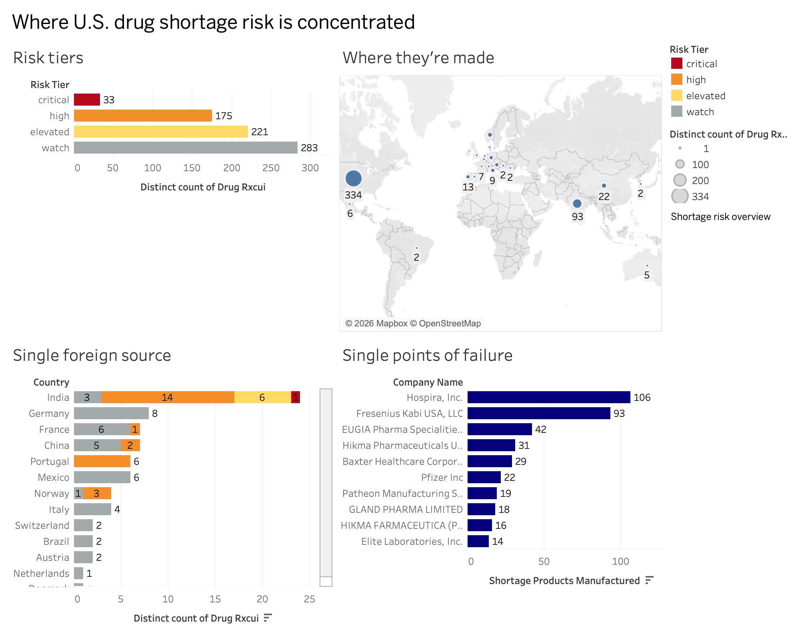
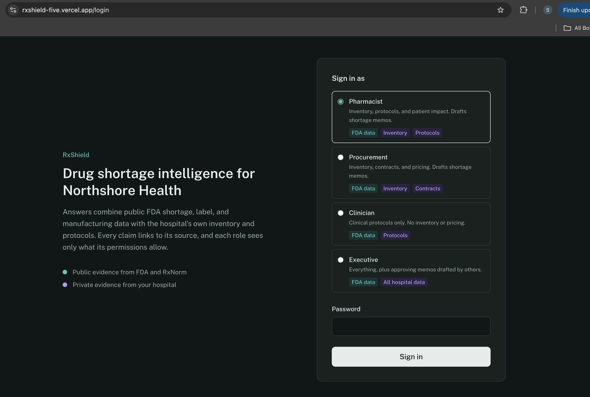
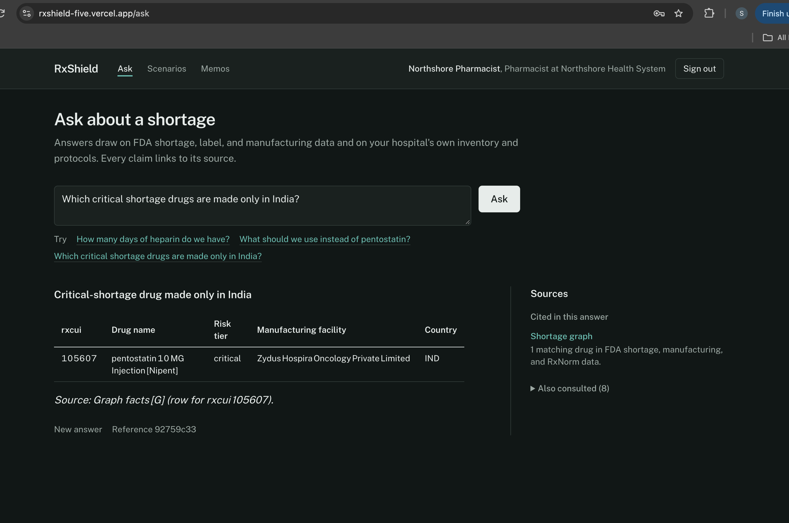
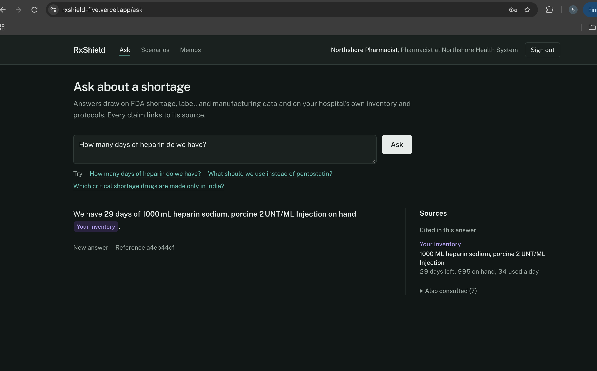
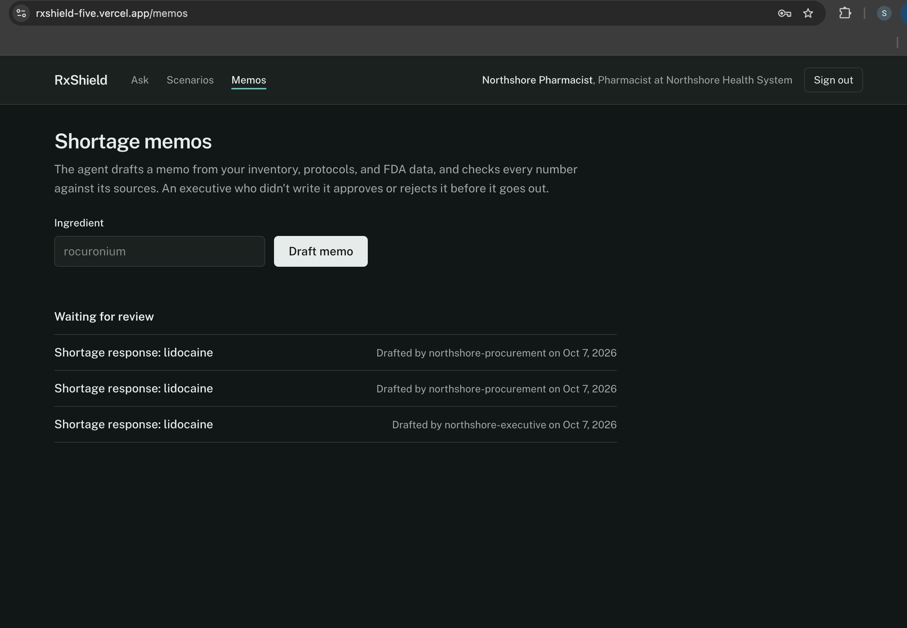
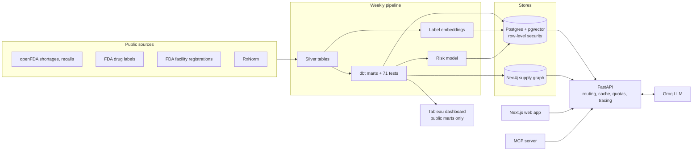

# RxShield

**Drug shortage intelligence for hospital pharmacy teams.** RxShield answers questions about U.S. drug shortages by combining public FDA data, a manufacturing supply graph, and each hospital's private inventory, contracts and protocols, with permissions enforced in the database rather than in the prompt.

It starts from the kind of question a pharmacist asks on an ordinary morning: *how many days of heparin do we have, and what do we do if it runs out?*

**Live app:** [rxshield-five.vercel.app](https://rxshield-five.vercel.app) (demo access available on request)



| | |
|---|---|
|  |  |
| Four roles, four views of the same hospital. The database decides who sees what. | A supply chain question no single document can answer, solved by walking the graph. |
|  |  |
| The hospital's own numbers, cited to its own inventory. | The agent drafts. An executive who didn't write it decides. |

## What it answers

| Question | How it is answered |
|---|---|
| "How should Nipent vials be stored?" | Vector search over FDA label text |
| "Which critical shortage drugs are made only in India?" | Text-to-Cypher over a Neo4j supply graph |
| "How many days of heparin do we have?" | The hospital's private inventory, scoped by row-level security |
| "What happens if India stops shipping for 30 days?" | Outage simulation over the graph, with patient impact from active orders |
| "Draft a shortage memo for rocuronium" | A LangGraph agent with code-built tables, a validator, and executive approval |

Every answer cites its sources: label sections, graph results, inventory rows or protocols.

## Results

**Retrieval quality** (gold answers computed from the graph and the database, not written by hand)

| Question set | Vector only | GraphRAG | Routed |
|---|---|---|---|
| Development set, 12 questions | 42% | 100% | 100% |
| Held-out set, 8 public questions | 50% | 100% | 100% |

**Private data and permissions** (held-out, answered as real users through the tenant pipeline)

| Test | Result |
|---|---|
| Users get their own hospital's exact figure (4 questions) | 4 of 4 correct |
| Wrong role or wrong hospital is denied (3 questions) | 3 of 3, none of 14 protected values leaked |
| Red team: role escalation, prompt injection, cross-tenant, write and exfiltration attempts (6 attacks) | 6 of 6 blocked, no data changed |

**Performance** (full findings in [docs/slos.md](docs/slos.md))

- Semantic cache answers repeated questions about 15x faster at the median, with no LLM tokens.
- Deployed database-bound requests have a 63 ms median, because the API runs in the same region as the database.
- On the free tier (0.15 vCPU), CPU-bound paths take seconds and capacity is about 1 request per second, with zero errors under load.

## Architecture



## Key design decisions

- **Permissions live in Postgres, not the prompt.** The API connects as a restricted role. Row-level security filters every query by the caller's hospital and role, so a model that is talked into leaking data has nothing to leak.
- **Code owns the numbers.** In shortage memos, the inventory table is generated in code. A validator rejects drafts with numbers missing from the evidence, an edited table, or uncited recommendations.
- **Four-eyes approval in the database.** A memo must be approved by an executive who did not draft it. Self-review is blocked by the database itself, rejections require a note, and each memo is reviewed once.
- **Cache keyed by tenant, role and data version.** Cached answers never cross hospitals or roles, and they expire automatically when new FDA data loads.
- **Safe weekly refresh.** Unchanged label passages reuse their embeddings, the new table is swapped in within one transaction, and network calls retry with backoff.
- **No approval tool over MCP.** AI assistants can ask, simulate and draft. Approving stays with a person.

## Tech stack

Python, FastAPI, Next.js, PostgreSQL with pgvector (Supabase), Neo4j Aura, dbt, LangGraph, Groq, FastEmbed (bge-small), scikit-learn, FHIR R4B, Model Context Protocol, Tableau, Locust, GitHub Actions, Render, Vercel.

## Repository map

| Folder | Contents |
|---|---|
| `ingestion/` | Fetchers for openFDA, labels, facilities and RxNorm; silver tables; the full pipeline runner |
| `dbt/` | Staging models, marts and data tests |
| `graph/` | Neo4j graph build, single-point-of-failure analysis, text-to-Cypher |
| `retrieval/` | Vector RAG, GraphRAG, the router, the tenant pipeline and the semantic cache |
| `tenancy/` | Schema, row-level security, roles, synthetic hospital data, onboarding of new hospitals |
| `agent/` | The shortage memo agent and its validator |
| `simulation/` | Outage what-if and patient impact |
| `ml/` | Shortage risk model training and scoring |
| `api/` | FastAPI app and authentication |
| `web/` | Next.js front end |
| `rxshield_mcp/` | MCP server exposing RxShield to AI assistants |
| `observability/` | Request tracing |
| `evals/` | Benchmarks, held-out set, red team, LLM judge, cost report |
| `loadtest/` | Locust load tests and SLO checks |
| `tableau/` | Export of public marts and the dashboard workbook |

## Run it locally

Requires Python 3.12, Node 20+, a Supabase (or Postgres with pgvector) database, a Neo4j database and a Groq API key.

```bash
git clone https://github.com/Sakshi3027/rxshield.git
cd rxshield
pip install -r requirements.txt
cp .env.example .env   # then fill in every value
```

Build the database in this order:

```bash
python -m tenancy.setup              # schema, app role, row-level security, tenants and users
python -m ingestion.pipeline         # public data, dbt, embeddings, graph, risk scores
python -m tenancy.seed_data          # synthetic formularies and contracts
python -m tenancy.seed_credentials   # demo passwords for seeded users
python -m tenancy.seed_orders        # synthetic FHIR medication orders
python -m tenancy.private_docs       # synthetic hospital protocols, embedded
```

Start the API and the web app:

```bash
uvicorn api.main:app --reload
cd web && npm install && npm run dev
```

## Tests and evaluations

```bash
pytest tests/ -q                                                        # 158 tests
python -m evals.benchmark --systems=baseline,graph_rag,routed           # development set
python -m evals.benchmark --file=evals/questions_holdout.json --systems=baseline,graph_rag,routed
python -m evals.redteam                                                 # adversarial set
```

## Notes from building it

- **The first weekly refresh died at 38 minutes.** Re-embedding all 11,260 label passages every week ran the CI machine out of memory. Now only changed passages get new vectors: the next run needed 21, and the whole refresh takes about 16 minutes.
- **The model once dropped an urgent drug from a memo's inventory table.** That's why the table is now built in code and the model only marks where it goes.
- **Production was faster than the laptop, and slower.** Database calls got quicker because the API sits next to the database. Anything CPU-heavy got 4 to 8 times slower on a 0.15 vCPU instance. Neither showed up in local testing.

## Known limitations

- **Cross-product attribution in memos.** The validator confirms every number exists in the evidence, not that it is attached to the right product. A memo can occasionally attribute one product's limit to another. Executive review catches this, and a per-product check is the next improvement.
- **Small evaluation sets.** 12 development and 15 held-out questions give strong signals, not precise rates.
- **Free-tier capacity.** The deployed API handles about 1 request per second. Latency targets in `docs/slos.md` assume a dedicated CPU.
- **Synthetic hospital data.** All hospitals, inventory, contracts, orders and protocols are generated. Public FDA data is real.

## Data and disclaimer

Public data comes from openFDA, FDA structured product labels, FDA establishment registrations and NLM RxNorm. RxShield is a portfolio project, not a medical device, and its output is not clinical advice.

## License

See [LICENSE](LICENSE).